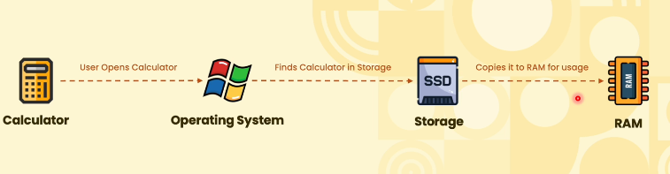
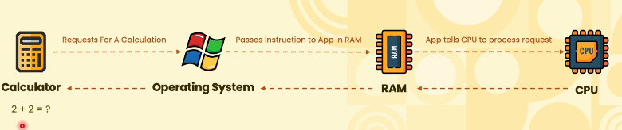
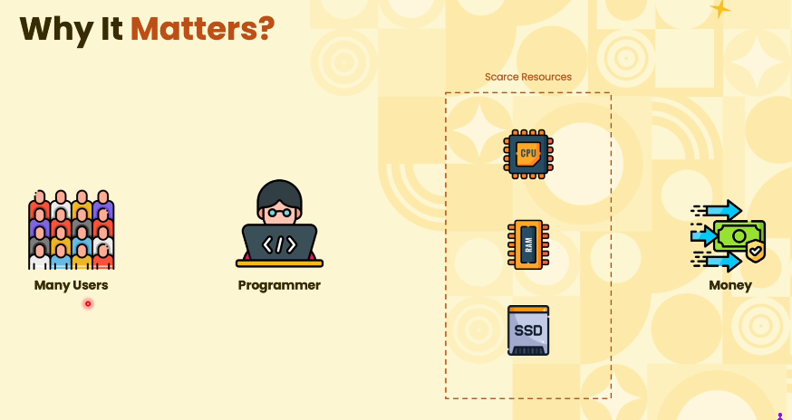

# What is a Computer?

## Definition of a Computer

A computer is an electronic device that processes data, executes instructions, and performs tasks through hardware and software to solve problems and automate operations.

**Hardware:** The physical components of a computer, including the processor, memory, and storage devices.

**Software:** Programs and applications that provide instructions for the hardware to perform specific tasks.

## Three Important Components of Hardware

1. **Central Processing Unit (CPU):** The CPU is the brain of the computer, responsible for executing instructions and processing data.

2. **Storage:** Storage is where data and programs are saved permanently, such as on a hard drive or SSD.

3. **Random Access Memory (RAM):** Memory (RAM) temporarily holds data and instructions for quick access by the CPU while tasks are being executed.

## Who Manages These Components?

User Input → OS → Computer Hardware (CPU, Storage, RAM)

## Opening a Calculator Application

Application on Windows → Calculator Application → OS → Storage → RAM

The moment we switch off the PC, the data stored in RAM will be lost.

## How Does a Calculator Work?

