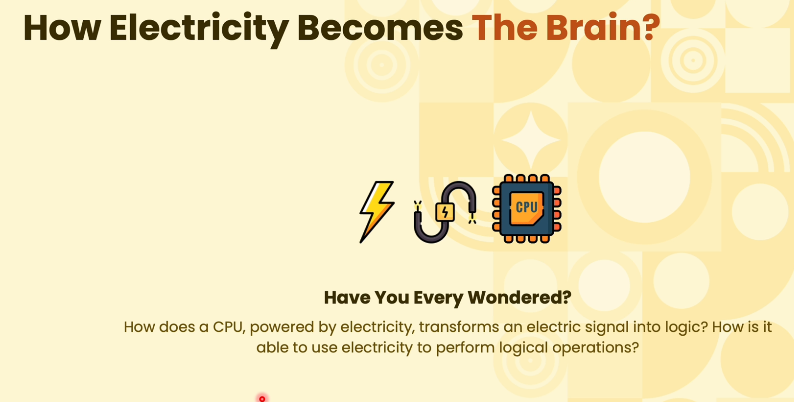
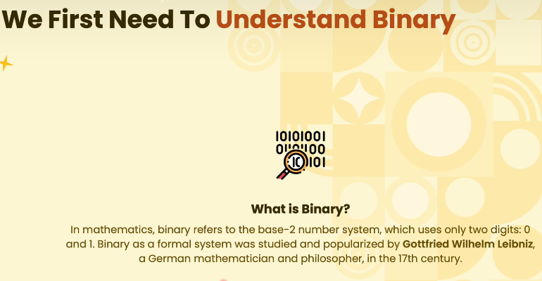
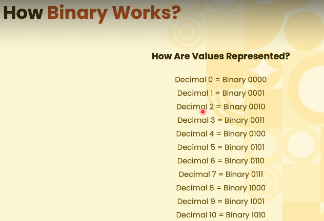
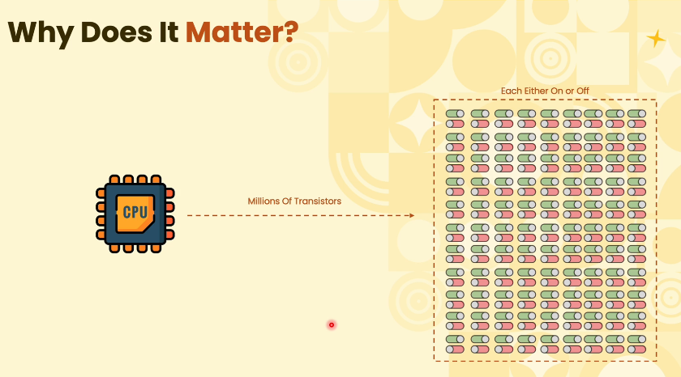
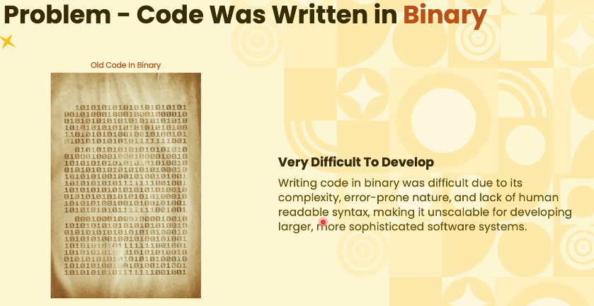
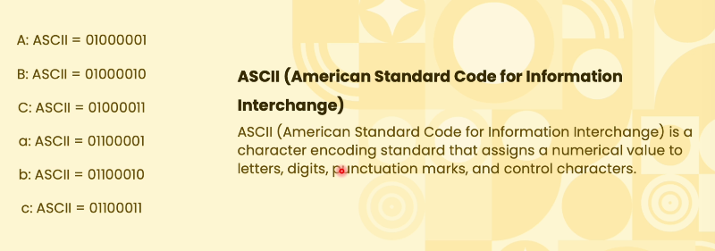
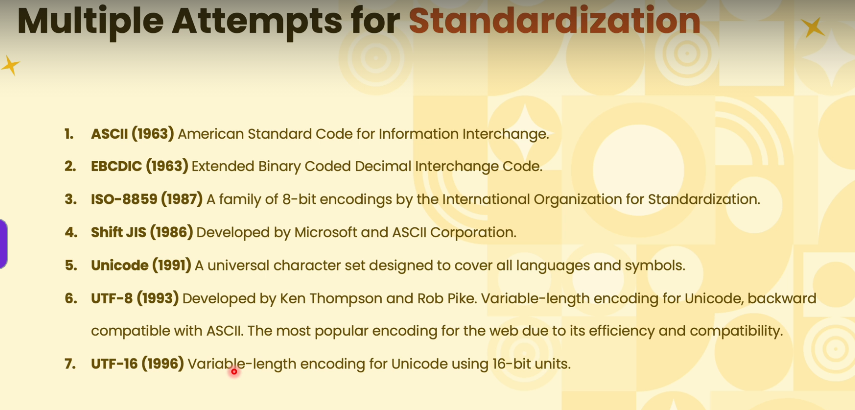
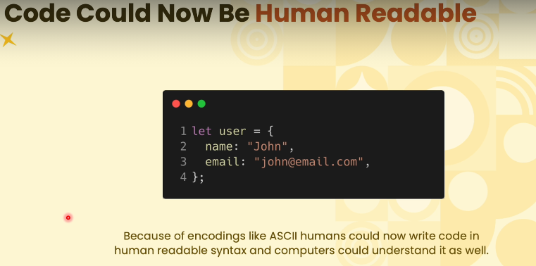
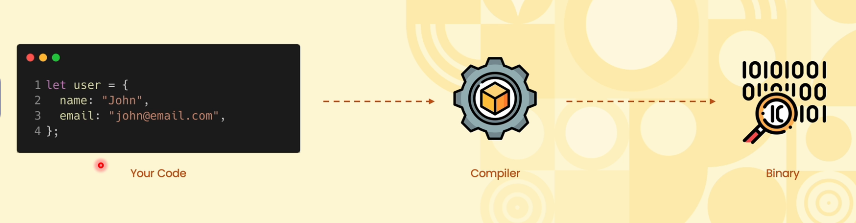

# How Does the CPU Work? – Binary and ASCII

## What Is Binary?

In mathematics, binary refers to the base-2 number system, which was popularized by Gottfried Wilhelm Leibniz.

## How Does Binary Work?

Binary is a number system that uses only two digits: `0` and `1`.

For example:

- Decimal 0 = Binary 0000
- Decimal 1 = Binary 0001
- Decimal 2 = Binary 0010
- Decimal 3 = Binary 0011
- And so on, as shown in the image below.

## Is Binary Like a Switch?

Yes, binary works similarly to an electrical switch:

- `1` – Represents ON.
- `0` – Represents OFF.

## Why Does Binary Matter?

Computers contain millions or even billions of tiny transistors that act like electrical switches, representing two states: ON (`1`) and OFF (`0`). This allows computers to process and store information using binary.
n

## Problem: Code Was Written in Binary?

Writing and understanding code directly in binary was very difficult for developers.

## Moving Towards Standardization

To make communication between computers more standardized, we got **ASCII (American Standard Code for Information Interchange)**.

ASCII assigns numerical values to characters.

We also have:

- **Uppercase (A–Z):** Starts at 65 (A) and ends at 90 (Z).
- **Lowercase (a–z):** Starts at 97 (a) and ends at 122 (z).
- **Special Characters:** ASCII also includes special characters, numbers, and control characters.

## Multiple Attempts at Standardization

## What Is UTF-8?

UTF-8 is one of the most widely used character encoding formats. It is backward-compatible with ASCII.

## How Is Code Converted into Binary?

