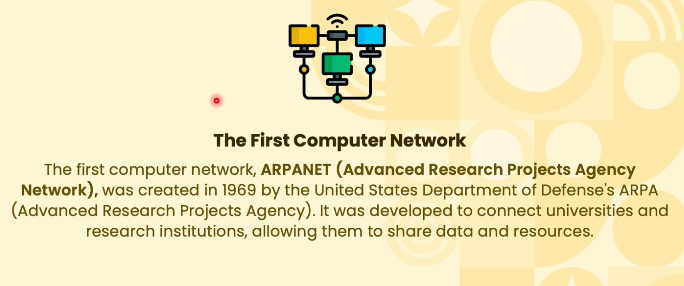
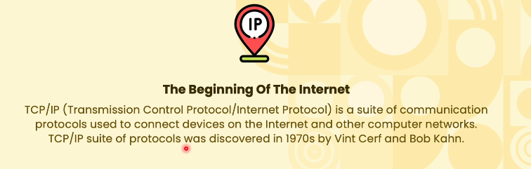
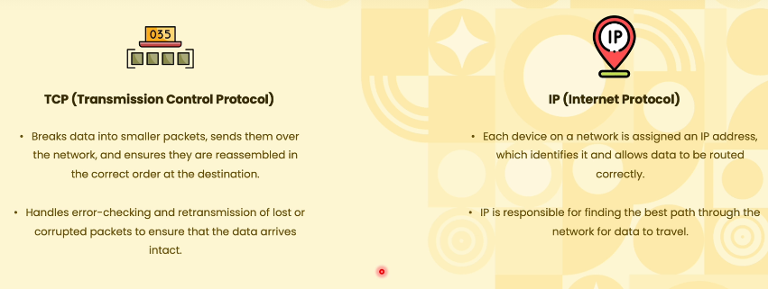
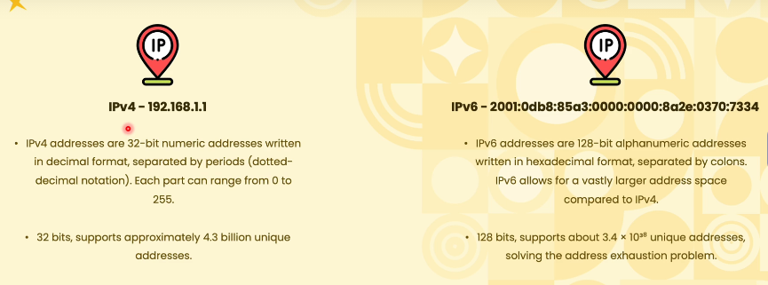
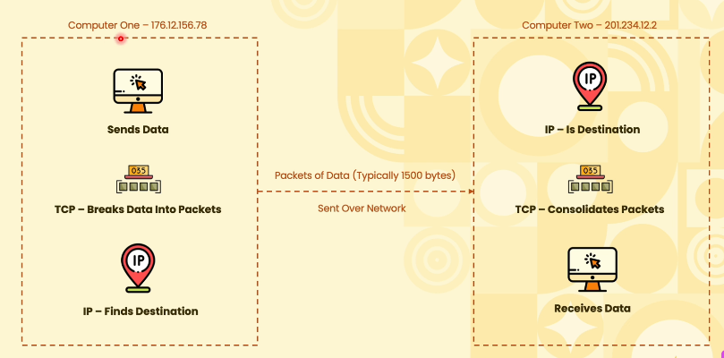
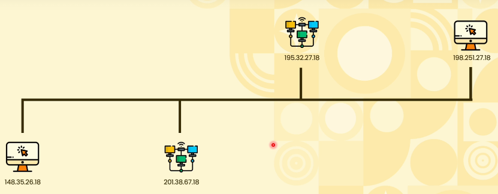

# What Is the Internet?

## How Can Computers Connect?

Computers can communicate with each other through networks. These networks allow computers to share data and resources.

## Discovery of TCP/IP

TCP/IP (Transmission Control Protocol / Internet Protocol) is a set of communication protocols that allows computers and networks to communicate with each other over the internet.

## How Does TCP/IP Work?

- **IP (Internet Protocol):** Responsible for addressing and routing data packets to the correct destination.
- **TCP (Transmission Control Protocol):** Responsible for breaking data into packets, ensuring reliable delivery, and reassembling the packets in the correct order.

## What Does an IP Address Look Like?

An IP address is a unique logical address used to identify a device on a network.

There are two main versions of IP addresses:

1. IPv4 (Internet Protocol Version 4)
2. IPv6 (Internet Protocol Version 6)

IPv6 is the newer version and supports a much larger number of unique IP addresses.

### 1. IPv4 (Internet Protocol Version 4)

- IPv4 uses a **32-bit** address format.
- It supports approximately **4.3 billion (2³²)** unique IP addresses.
- It consists of four numbers (octets) separated by dots (`.`).
- Each octet has a value ranging from **0 to 255**.

**Example:** `192.168.1.1`

**How do we get 192.168.1.1?**

Each number represents 8 bits (1 byte).

- 192 → 11000000
- 168 → 10101000
- 1 → 00000001
- 1 → 00000001

Therefore, an IPv4 address contains 4 octets × 8 bits = 32 bits.

Octet = a group of 8 bits (1 byte)

### 2. IPv6 (Internet Protocol Version 6)

- IPv6 uses a **128-bit** address format.
- It supports approximately **3.4 × 10³⁸** unique IP addresses.
- It uses hexadecimal values (0–9 and A–F).
- It is separated by colons (`:`).
- It supports a much larger address space than IPv4.

**Example:** `2001:0db8:85a3:0000:0000:8a2e:0370:7334`

## What Happens When You Send Data?

When you send data over the internet, it is divided into smaller units called packets. These packets travel through different networks and routers to reach the destination.

## What Is the Internet?

The **Internet is a network of networks** that connects millions of computers and other devices worldwide, allowing them to communicate and exchange information.

