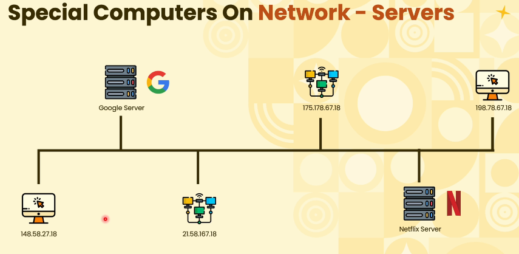
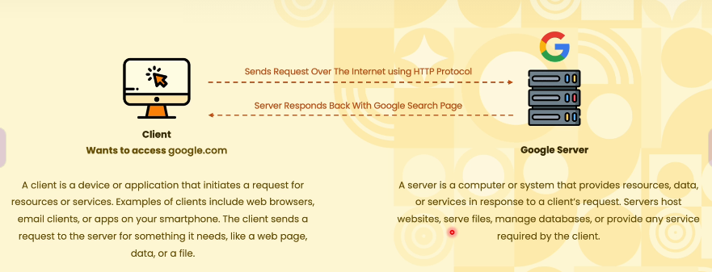
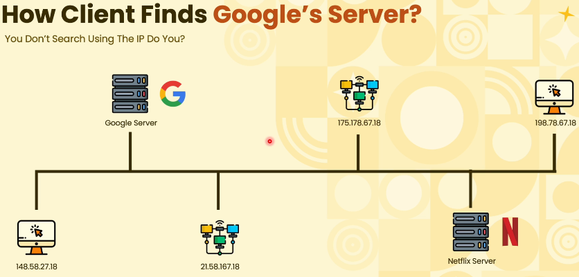
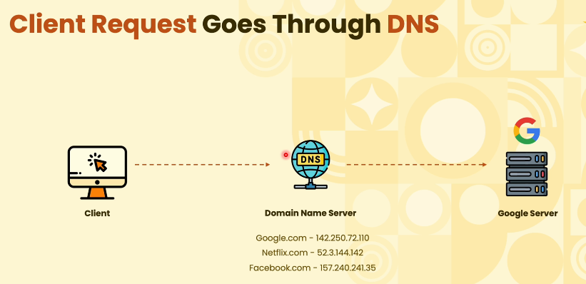
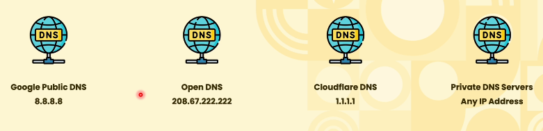
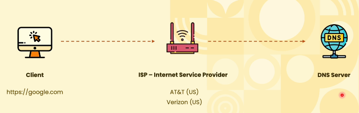
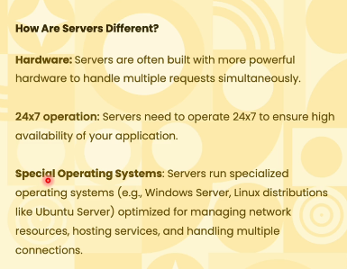

# Understanding Servers and DNS

## What Is a Server?

Special computers on a network that provide services, resources, or data to other computers are called **Servers**.

## The Client-Server Relationship

A client is a device or application that requests data or services, while a server is a computer or system that receives the request and provides the required response.

- **Client:** Sends requests.
- **Server:** Processes requests and sends responses.

## How Does a Client Find a Server?

Users generally do not type an IP address directly into their browsers. Instead, they enter a human-readable domain name, such as `google.com`.

The computer needs to find the IP address associated with that domain name to communicate with the server.

## What Is DNS (Domain Name System)?

DNS stands for **Domain Name System**.

DNS translates human-readable domain names (such as `google.com`) into IP addresses that computers use to communicate with each other.

It works like the phonebook of the internet.

## How Does a Client Request Go Through DNS?

1. The user enters a domain name (e.g., `google.com`) in the browser.
2. The browser checks whether the IP address is already available in its cache.
3. If it is not available, the request goes to a DNS resolver.
4. The DNS resolver finds the IP address associated with the domain name.
5. The IP address is returned to the client.
6. The client uses that IP address to connect to the server.
7. The server processes the request and sends a response.

## Who Owns the DNS Servers?

DNS servers are owned and managed by different organizations, including:

- **Internet Service Providers (ISPs):** Provide DNS services to their customers.
- **Public DNS Providers:** Organizations such as Google and Cloudflare provide public DNS services.
- **Organizations and Companies:** Maintain their own DNS infrastructure.
- **DNS Hosting Providers:** Manage DNS records for websites and domains.

## Who Decides Which DNS Server to Use?

The DNS server is generally configured through:

- **ISP:** Your Internet Service Provider may automatically assign a DNS server when you connect to the internet.
- **Router:** Your router can provide DNS settings to connected devices.
- **Operating System:** You can manually configure a preferred DNS server on your computer.
- **Public DNS:** You can choose public DNS providers such as Google DNS or Cloudflare DNS.

## How Are Servers Different?

Servers can differ based on their purpose, hardware, processing power, storage capacity, and the services they provide.

Some common types of servers are:

1. **Web Server:** Hosts websites and responds to HTTP/HTTPS requests.
2. **Database Server:** Stores, manages, and retrieves data.
3. **Application Server:** Runs application logic and processes business operations.
4. **File Server:** Stores and shares files over a network.
5. **Mail Server:** Handles sending, receiving, and storing emails.

## What Is a Data Center?

A **Data Center** is a physical facility that contains multiple servers, networking equipment, storage systems, and other infrastructure.

Data centers provide the computing power, storage, networking, cooling, and security required to run websites, applications, and online services.

In simple terms, a data center is a facility where many servers are installed and managed together.