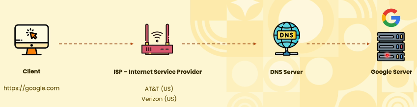
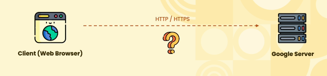
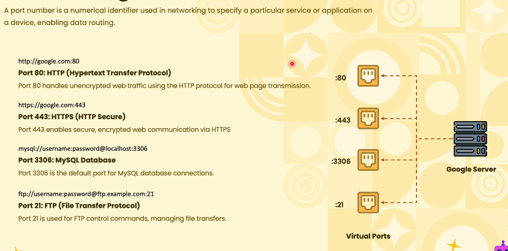
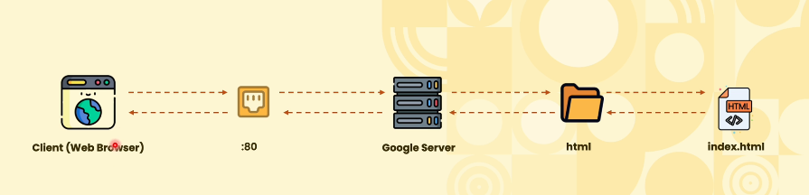
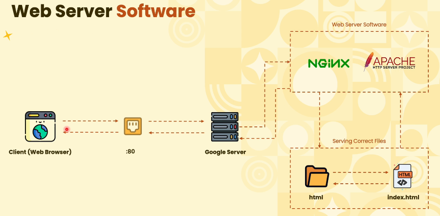
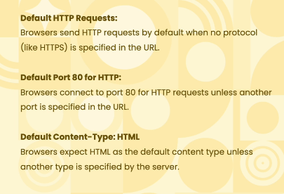

# Port Numbers and Request-Response Lifecycle

## What Is a Complete Request?

A complete request involves communication between a client (browser) and a server. The client sends a request, and the server processes it and returns a response.

## How Do Servers Understand Requests?

Servers understand requests using standard communication protocols such as HTTP (Hypertext Transfer Protocol) and HTTPS (Hypertext Transfer Protocol Secure).

These protocols define how requests and responses should be structured and communicated between clients and servers.

## Introducing Port Numbers

A port number is a logical number used to identify a specific application or service running on a computer.

- An IP address identifies the computer or device.
- A port number identifies the specific service or application running on that device.

For example:

- HTTP → Port `80`
- HTTPS → Port `443`
- SSH → Port `22`
- MySQL → Port `3306`

**Example:** `192.168.1.1:8080`

Here:
- `192.168.1.1` → IP Address
- `8080` → Port Number

## How Does a Server Process a Request?

1. The client sends an HTTP/HTTPS request to the server's IP address and port number.
2. The server receives the request through the specified port.
3. The web server forwards the request to the appropriate application or resource.
4. The application processes the request.
5. The server generates an HTTP response.
6. The response is sent back to the client.

## Web Server Software

Web server software is responsible for receiving HTTP/HTTPS requests and delivering the appropriate responses.

Some popular web server software includes:

- **Nginx:** A high-performance web server that can serve static files, handle reverse proxy requests, and distribute traffic.
- **Apache:** A widely used web server that handles HTTP requests and serves website resources.

Web servers use the requested port number and hostname (domain name) to determine how to handle incoming requests and which website or application should respond.

## Things to Know About Browsers

