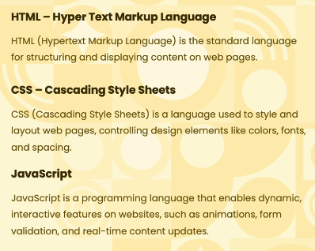
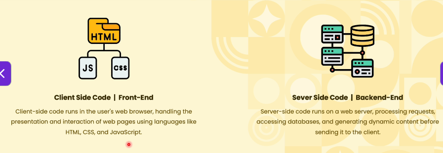

# Understanding a Website

## Additional Files Used with HTML

A website is not built using HTML alone. It generally uses additional files to define its appearance, functionality, and behaviour.

Some commonly used files are:

- **HTML (.html):** Defines the structure and content of a webpage.
- **CSS (.css):** Defines the styling, layout, colours, and appearance of a webpage.
- **JavaScript (.js):** Adds interactivity and dynamic behaviour to a webpage.
- **Images (.png, .jpg, .svg):** Used to display images, icons, and graphics.
- **Fonts:** Used to define the typography and text appearance.

## Client-Side vs Server-Side

Web applications generally have two main parts: Client-Side and Server-Side.

### 1. Client-Side (Frontend)

Client-side refers to the part of a website that runs in the user's browser.

- HTML defines the structure.
- CSS handles the styling and layout.
- JavaScript handles interactivity and dynamic behaviour.
- The browser renders the webpage and displays it to the user.

**Examples:** React.js, Angular, Vue.js, HTML, CSS, JavaScript.

### 2. Server-Side (Backend)

Server-side refers to the part of a website that runs on the server.

- Handles business logic and application operations.
- Processes client requests.
- Communicates with databases.
- Performs authentication and authorization.
- Sends responses back to the client.

**Examples:** Python (Django, FastAPI), Java (Spring Boot), Node.js, PHP.

