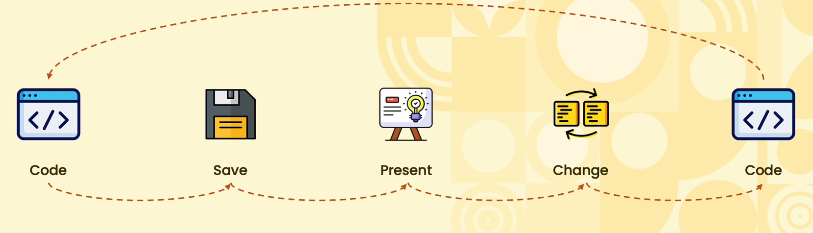
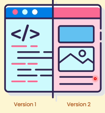
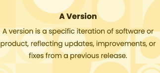
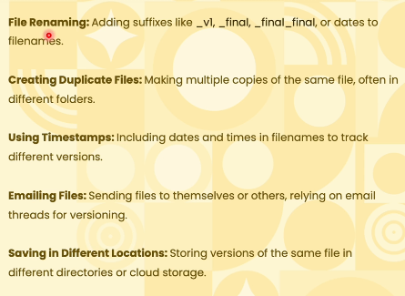
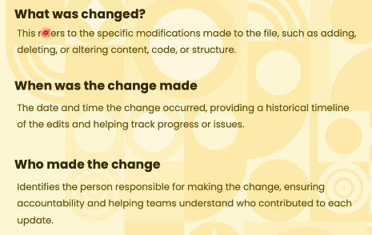
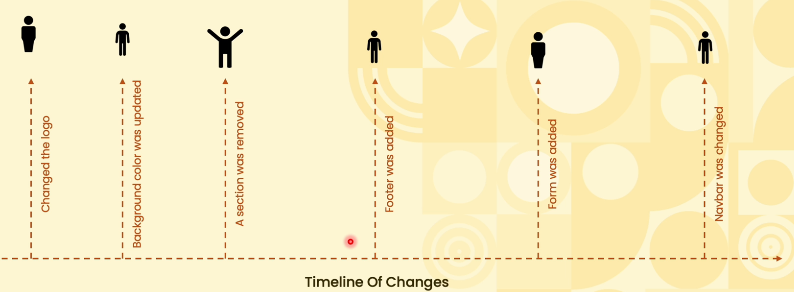
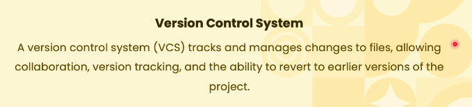
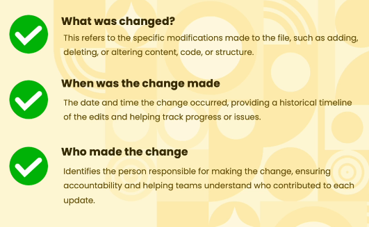

# Common Programming Workflow

## Basic Programming Workflow

Code → Save → Present → Change → Code

In a typical programming workflow, developers write code, save it, present or run the application, and make changes based on requirements or feedback.

We continuously make changes and save our work. Therefore, it is important to log or record every change to maintain different versions of our project.

Versioning helps us understand:
- Where we started.
- What changes we made.
- Which version we are currently working on.
- What was changed between versions.

## Creating Different Versions

We create different versions of our project to keep track of changes over time.

## How Do People Version Files?

Developers sometimes create multiple copies of files or folders to maintain different versions of their work.

However, this approach becomes difficult to manage as the project grows.

## A Big Problem: Lack of History

When we maintain multiple copies of files, it becomes difficult to track the complete history of changes.

Some common problems are:

- Difficult to identify what changes were made.
- Difficult to know who made the changes.
- Difficult to restore an older version.
- Difficult to compare different versions.

## A Bigger Problem: Multiple People Working Together

When multiple developers work on the same project, managing different versions becomes even more complicated.

Some common problems are:

- Multiple developers modifying the same files.
- Changes overwriting each other.
- Difficulty combining everyone's work.
- Difficulty tracking individual contributions.

## Problem Solved: Version Control System (VCS)

A **Version Control System (VCS)** is a tool that tracks and manages changes made to files over time.

It helps developers maintain the history of their projects, collaborate with other developers, and restore previous versions whenever required.

Examples:
- Git
- Apache Subversion (SVN)
- Mercurial

## A Big Problem Solved

Version Control Systems solve these problems by providing:

- **History Tracking:** Records changes made to the project over time.
- **Version Management:** Maintains different versions of the project.
- **Collaboration:** Allows multiple developers to work on the same project.
- **Change Tracking:** Shows who made changes and what was changed.
- **Restore Previous Versions:** Allows developers to return to an earlier version when needed.