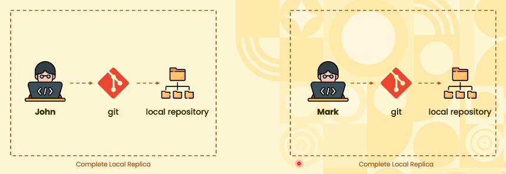
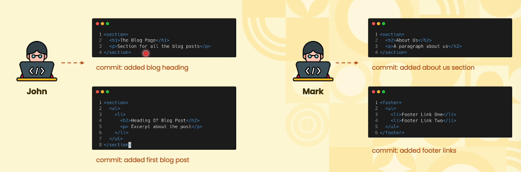
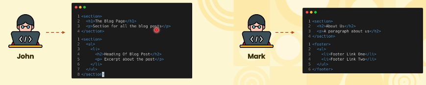

# Understanding Git and GitHub

## What Is Git?

Git is a **Distributed Version Control System (DVCS)** that tracks and manages changes made to source code over time.

It helps developers maintain the history of their projects and collaborate with other developers.

Git keeps track of:

- **What:** What changes were made to the source code?
- **Who:** Who made those changes?
- **When:** When were those changes made?

## What Is Distributed Version Control?

Distributed Version Control means every developer has their own local copy of the complete repository, including its version history.

Even if multiple developers are working on the same application, they can work independently on their local machines without constantly depending on a central server.

They can later share and synchronize their changes with other developers.

## Enabling Individual Version Control

For example, consider two developers: **John and Mark**.

- John has his own local copy of the project and can make changes independently.
- Mark also has his own local copy and can make changes independently.
- Both developers can track their changes using Git.
- They can work on different features without directly affecting each other's local work.

## In a Team, Individual Version Control Is Not Enough

When multiple developers work on the same application, we need to combine their source code to create the final application.

Git provides the ability to work with remote repositories so developers can share and synchronize their changes.

A **Remote Repository** is a version of the project hosted on a server that developers can access and collaborate on.

This is where GitHub comes in.

**GitHub** is a cloud-based platform for hosting Git repositories. It allows developers to create remote repositories, share source code, collaborate with team members, and manage projects.

Developers can push their local changes to GitHub and pull changes made by other developers.

## Git vs GitHub

| Git | GitHub |
|---|---|
| Git is a version control system. | GitHub is a cloud-based platform. |
| Tracks changes in source code. | Hosts Git repositories online. |
| Works locally on your computer. | Provides remote repository hosting. |
| Helps manage project history. | Helps developers collaborate on projects. |
| Can work without an internet connection. | Requires an internet connection for online collaboration. |