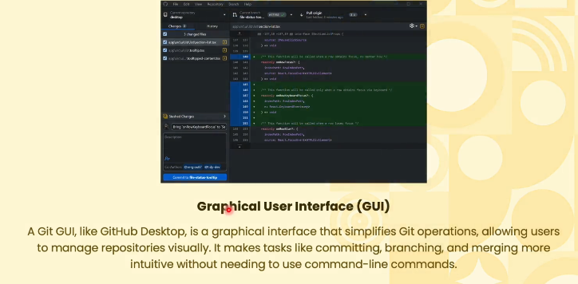
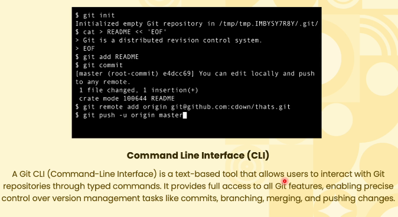
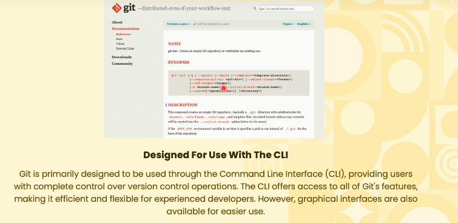
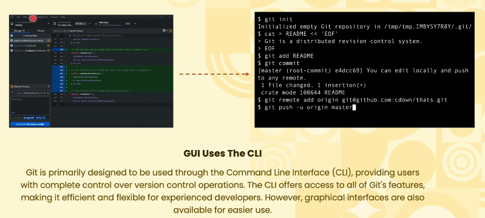
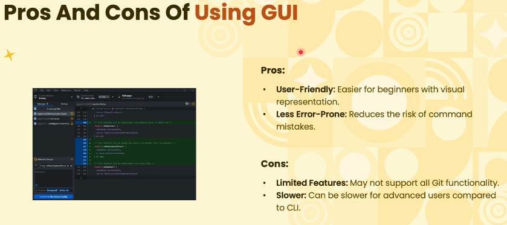
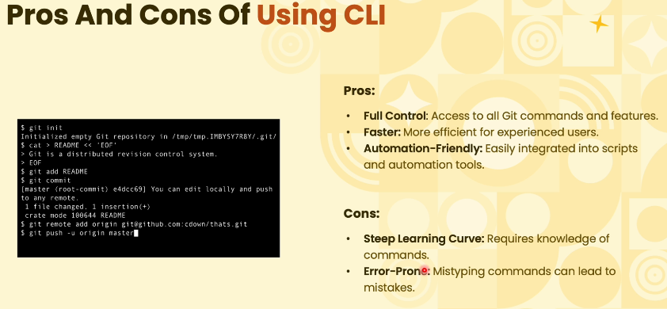

# Git Graphical User Interface (GUI) vs Command Line Interface (CLI)

## Git Graphical User Interface (GUI)

A Graphical User Interface (GUI) allows developers to interact with Git using visual elements such as buttons, menus, icons, and windows instead of typing commands.

Examples:
- GitHub Desktop
- Sourcetree
- GitKraken
- Visual Studio Code (Source Control)

## Git Command Line Interface (CLI)

A Command Line Interface (CLI) allows developers to interact with Git by typing commands in a terminal.

Examples:
- Git Bash
- Command Prompt (CMD)
- PowerShell
- VS Code Terminal

## Git Was Designed for the CLI

Git was originally designed as a command-line tool. Developers use Git commands to manage repositories, track changes, create branches, merge code, and perform other version control operations.

## GUI Uses the CLI

Most Git GUI applications provide a visual interface for performing Git operations. They use Git commands in the background to execute those operations.

This allows developers to perform Git operations without manually typing every command.

## Pros and Cons of Using GUI

**Pros:**
- Easy to use, especially for beginners.
- Provides a visual representation of changes.
- Makes it easier to view commit history and branches.
- Reduces the need to remember Git commands.

**Cons:**
- Some advanced Git operations may not be available.
- Less control over certain Git operations.
- Developers may become dependent on the GUI.
- Troubleshooting complex Git issues can be difficult without CLI knowledge.

## Pros and Cons of Using CLI

**Pros:**
- Provides complete control over Git operations.
- Supports advanced Git commands and operations.
- Faster for developers who are comfortable with commands.
- Helps developers understand how Git works internally.
- Can be used in scripts and automation.

**Cons:**
- Requires knowledge of Git commands.
- Can be difficult for beginners.
- Incorrect commands may cause unwanted changes.
- Developers need to remember command syntax.