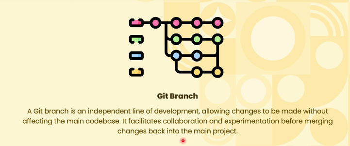
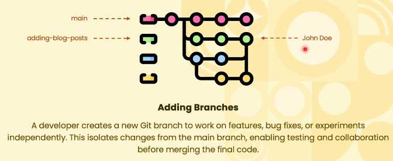
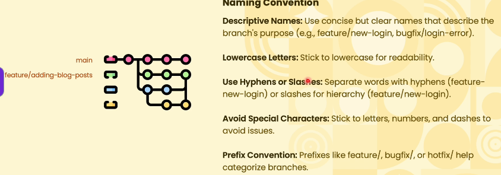
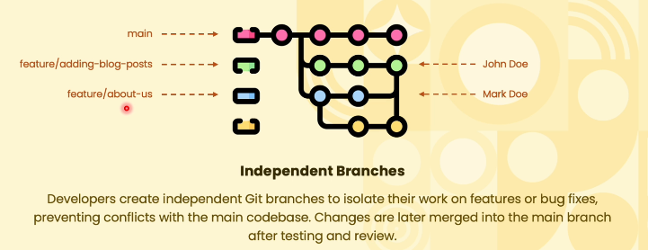
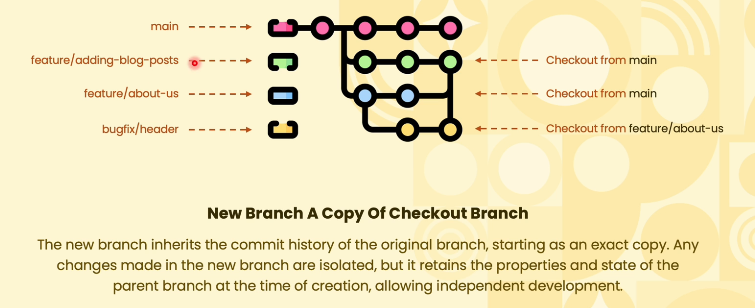
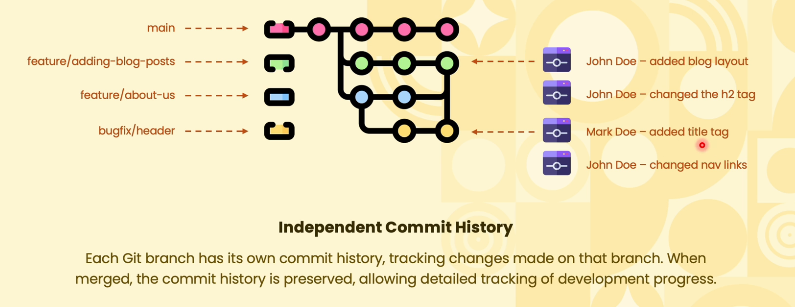
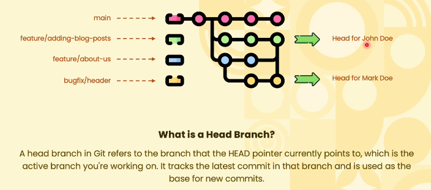

# Understanding Git Branches

## What Is a Main Branch?

A **Main Branch** is the primary branch of a Git repository. It generally contains the stable and working version of the project.

- It acts as the central branch of the project.
- Developers usually merge completed features into the main branch.
- By default, Git uses `main` as the initial branch name in modern configurations.

## Creating New Branches for New Features

Instead of directly modifying the main branch, developers create separate branches for developing new features or fixing bugs.

This allows developers to work independently without affecting the main branch.

## How to Assign Branch Names?

Each branch should have a meaningful name based on the feature or task being developed.

Examples:

- `main` – Main project branch.
- `feature/login` – Developing a login feature.
- `feature/signup` – Developing a signup feature.
- `bugfix/navbar` – Fixing a navigation bar issue.
- `hotfix/payment` – Fixing an urgent payment issue.

## Developers Work on Independent Branches

Multiple developers can work on different branches independently.

For example:

- Developer John works on the adding blog posts feature.
- Developer Mark works on the about us feature.
- Both developers work independently without directly affecting each other's changes.
- Once their work is completed, their branches can be merged into the main branch.

## How Is a Branch Created?

A new branch is created from the currently checked-out branch.

This means the new branch starts from the same commit as the branch from which it was created.

**Example:**

If we create a new branch from `main`, the new branch initially contains the same files and commit history as `main` at that point.

## Commit History for Each Branch

Each branch has its own line of development.

- When a new branch is created, it initially shares the commit history of the branch from which it was created.
- When developers make new commits, those commits belong to their respective branches.
- Changes made in one branch do not automatically appear in another branch.
- Branches can later be merged to combine their changes.

## What Is HEAD in Git?

**HEAD** is a pointer that indicates the currently checked-out commit in Git.

Usually, HEAD points to the current branch. When we switch branches, HEAD moves to the newly selected branch.

**Example:**

- If we are working on the `main` branch, HEAD points to `main`.
- If we switch to `feature/login`, HEAD points to `feature/login`.

