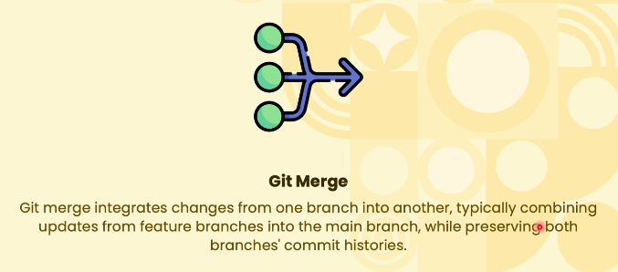
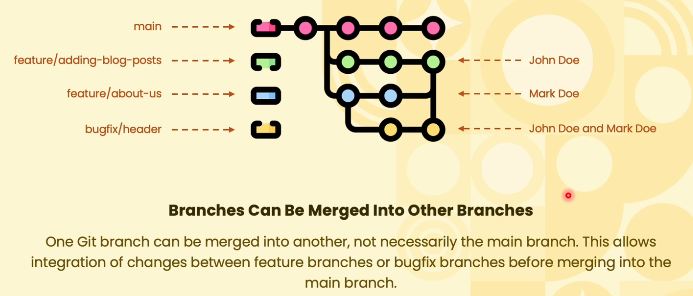
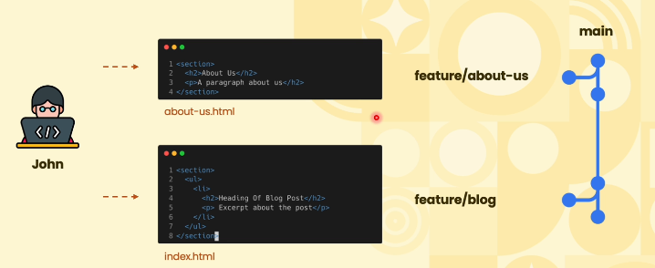
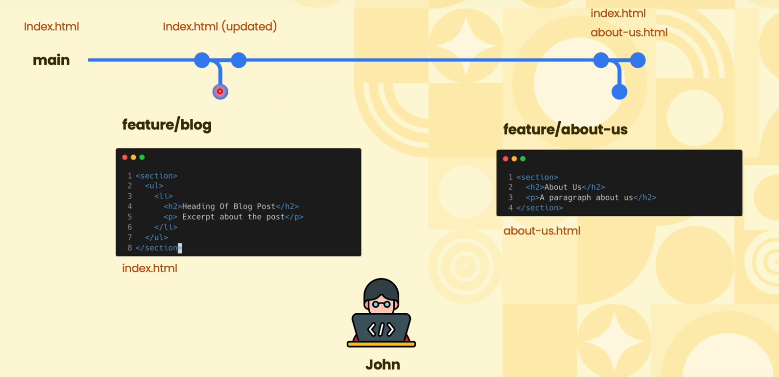
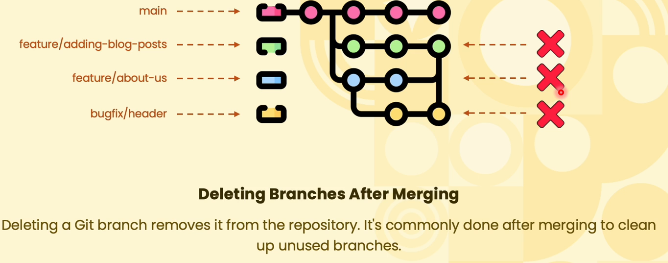

# Understanding Git Merge

## 1. What Is a Merge?

A **merge** is the process of combining changes from one branch into another branch.

For example, suppose you have two branches:

- `main` – The main project branch.
- `feature/login` – A branch where you developed the login functionality.

After completing the login feature, you can merge `feature/login` into `main` to bring those changes into the main branch.



## 2. Any Branch Can Be Merged into Another Branch

In Git, any branch can be merged into another branch.

For example:

- `feature/login` can be merged into `main`.
- `feature/signup` can be merged into `development`.
- `development` can be merged into `main`.
- `bugfix/navbar` can be merged into `feature/login`.

The branch you switch to before running the merge command is the **target branch**. The branch specified in the merge command is the **source branch**.



## 3. How Merging Works

Suppose you have two branches:

- `main`
- `feature/login`

You make changes and commit them in `feature/login`.

To merge those changes into `main`, follow these steps:

**Step 1: Switch to the target branch**

```bash
git switch main
```

**Step 2: Merge the source branch**

```bash
git merge feature/login
```

Git combines the changes from `feature/login` into `main`.

**Step 3: Verify the merge**

```bash
git log --oneline --graph
```



## 4. Git Merge Under the Hood

Git uses commit history to determine how to combine branches.

When merging two branches, Git identifies their **common ancestor**, which is the latest commit shared by both branches.

There are two common types of merges:

### A. Fast-Forward Merge

A fast-forward merge happens when the target branch has not received any new commits since the source branch was created.

Git simply moves the target branch pointer forward to the latest commit of the source branch.

```bash
git switch main
git merge feature/login
```

### B. Three-Way Merge

A three-way merge happens when both branches have new commits after they diverged from their common ancestor.

Git uses three versions to perform the merge:

1. Common ancestor commit.
2. Latest commit of the target branch.
3. Latest commit of the source branch.

Git combines the changes and creates a new **merge commit** when necessary.



## 5. Cleaning Up After Merging

After successfully merging a feature branch into the target branch, you can delete the feature branch if it is no longer needed.

**Step 1: Switch to the target branch**

```bash
git switch main
```

**Step 2: Delete the merged local branch**

```bash
git branch -d feature/login
```

**Step 3: Delete the remote branch (if it was pushed to GitHub)**

```bash
git push origin --delete feature/login
```

**Step 4: Verify the remaining branches**

```bash
git branch -a
```



**Note:** Deleting a branch after merging does not delete the commits that are already part of the target branch's history.

## Important Git Merge Commands

| Command | Purpose |
|---|---|
| `git merge branch-name` | Merge another branch into the current branch |
| `git merge --no-ff branch-name` | Create a merge commit instead of fast-forwarding |
| `git merge --abort` | Abort an ongoing merge |
| `git branch -d branch-name` | Delete a merged local branch |
| `git push origin --delete branch-name` | Delete a remote branch |
| `git log --oneline --graph --all` | View commit history and branch structure |

**Remember:** Always switch to the branch into which you want to merge before running `git merge`.